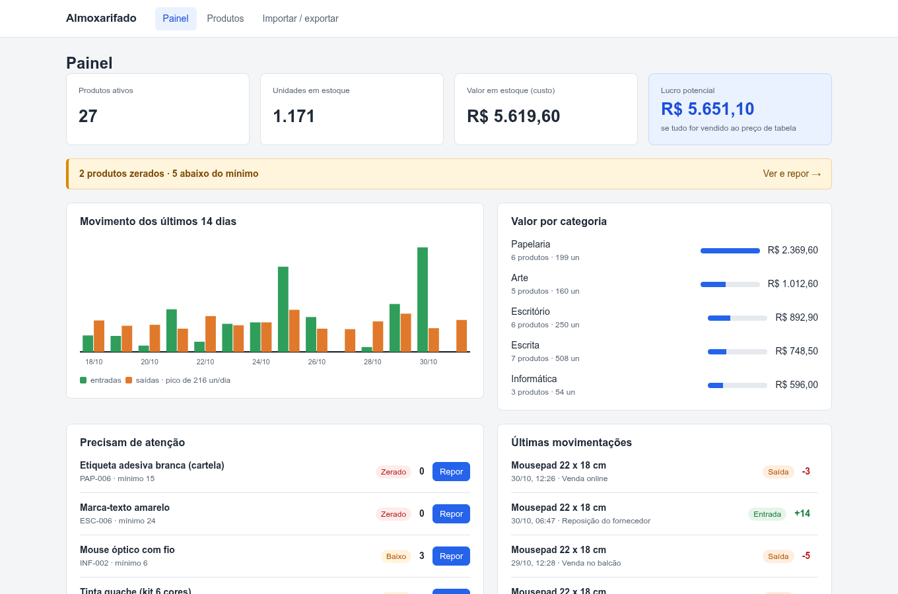
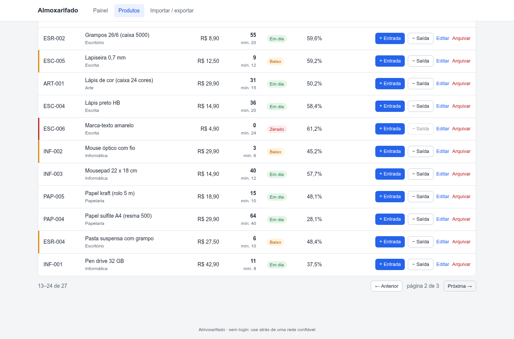
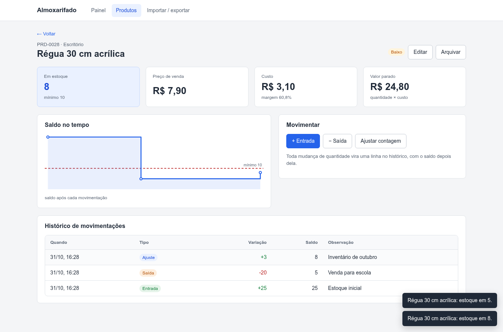
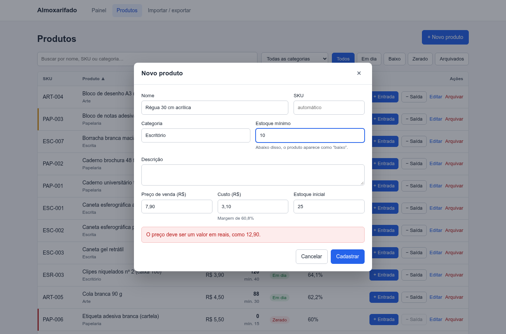
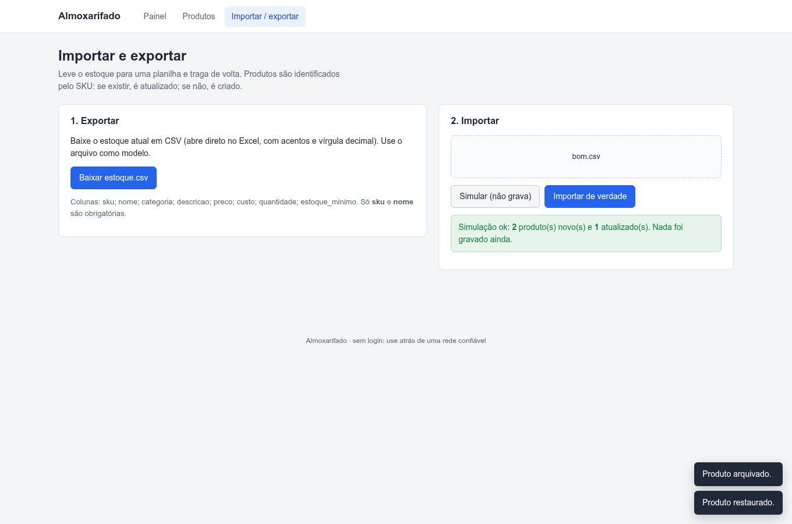
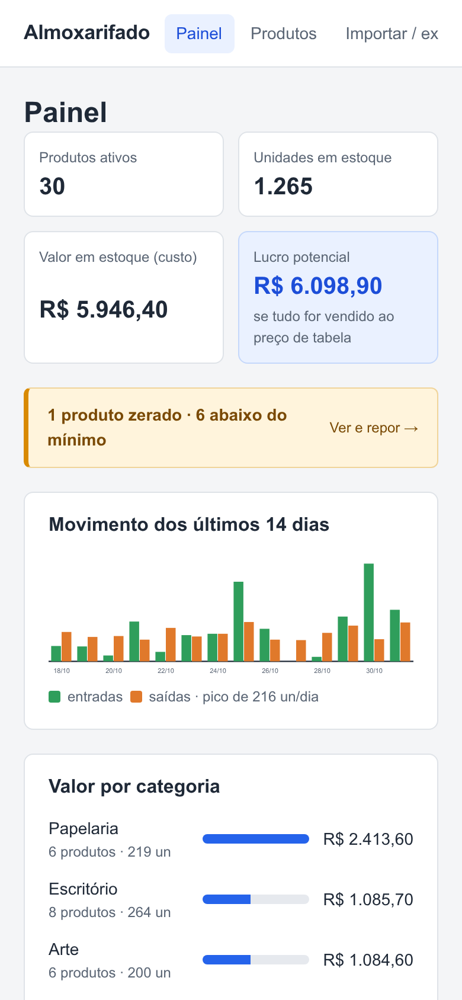

# Almoxarifado

Sistema de controle de estoque: cadastro de produtos, **movimentações com histórico** (entrada, saída e ajuste de inventário), alertas de estoque mínimo, painel com números e gráficos, busca, filtros, importação e exportação em CSV. API em **Express + SQLite** e front em **React + Vite**, com interface administrativa sóbria.

| Painel | Produtos | Produto |
|---|---|---|
|  |  |  |

| Novo produto | Importar CSV | Celular |
|---|---|---|
|  |  |  |

## O que tem

- **Produtos** com SKU (automático ou manual), categoria, preço de venda, custo, estoque mínimo e margem calculada.
- **Movimentações**: cada mudança de quantidade vira uma linha do histórico, com o saldo depois dela. A quantidade **não se edita direto**: só por entrada, saída ou ajuste de contagem. Saída maior que o estoque é recusada.
- **Situação do estoque** em dia, baixo (abaixo do mínimo) ou zerado, com selo e cor, nunca só cor.
- **Painel**: produtos, unidades, valor parado em estoque (custo), lucro potencial, movimento dos últimos 14 dias, valor por categoria, o que precisa de reposição e as últimas movimentações.
- **Lista** com busca **sem acento** ("lapis" acha "Lápis"), filtro por situação e categoria, ordenação por coluna e paginação. Tudo fica na URL: dá para compartilhar um filtro.
- **Página do produto** com gráfico de saldo no tempo e histórico completo.
- **Arquivar em vez de excluir**: o produto sai da lista, o histórico fica íntegro, e dá para restaurar.
- **Importar e exportar CSV** (por SKU: cria ou atualiza), com **simulação** antes de gravar. A importação é tudo ou nada e aponta o número da linha de cada problema.
- Dinheiro em **centavos inteiros** no banco e na API; o formulário aceita `1.234,50`.
- Interface corporativa padrão: fonte do sistema, fundo neutro, uma cor de destaque. Sem biblioteca de animação: num painel de estoque, o número certo na hora vale mais que efeito.

> Não há login: é uma ferramenta interna. Rode atrás de uma rede confiável ou de um proxy com autenticação.

## Rodando

Precisa de Node 22.13 ou mais novo (usa o SQLite embutido, `node:sqlite`: nada para compilar).

```bash
npm install
npm --prefix client install

npm run seed                 # opcional: papelaria de demonstração com histórico de 20 dias
npm run dev                  # API em http://localhost:3001 (cria o banco na 1ª vez)
npm --prefix client run dev  # front em http://localhost:5176 (proxy de /api para a 3001)
```

```bash
npm test                    # API: 22 testes (node:test + supertest)
npm --prefix client test    # front
npm --prefix client run lint
npm --prefix client run build
```

## Em produção

`npm --prefix client run build` gera `client/dist`, e o Express passa a servir o front no mesmo endereço da API. O `render.yaml` descreve o serviço no Render, com disco persistente para o SQLite.

## API

Todas as rotas em `/api`. Erros vêm como `{ "error": "mensagem", "details": [...] }`. Dinheiro em centavos (`priceCents`, `costCents`).

| Método | Rota | O que faz |
|---|---|---|
| GET | `/products?q=&status=&category=&sort=&order=&page=&pageSize=` | lista (status: `ok`, `baixo`, `zerado`, `arquivado`; sort: `name`, `sku`, `price`, `cost`, `quantity`, `category`, `updated`) |
| POST | `/products` | cria `{ name, sku?, category?, description?, price, cost, quantity, minQuantity }` (preço em reais ou `priceCents`) |
| GET / PUT / PATCH | `/products/:id` | lê; edita (a quantidade só muda por movimentação) |
| DELETE | `/products/:id` | arquiva (restaurar: `PATCH { "active": true }`) |
| GET / POST | `/products/:id/movements` | histórico; registra `{ type: "entrada" \| "saida" \| "ajuste", quantity, note? }` |
| GET | `/summary` | números do painel e série dos últimos 14 dias |
| GET | `/categories` | categorias em uso |
| GET | `/export.csv` | estoque em CSV (`;`, vírgula decimal, BOM para o Excel) |
| POST | `/import[?simular=1]` | corpo `text/csv`; cria ou atualiza por SKU, tudo ou nada |

Colunas do CSV (só `sku` e `nome` são obrigatórias; aceita `;` ou `,` e cabeçalhos com ou sem acento): `sku; nome; categoria; descricao; preco; custo; quantidade; estoque_minimo`. Células que começam com `=`, `+`, `-` ou `@` são protegidas na exportação contra injeção de fórmula.

## Migração da versão antiga

A primeira versão (2024) guardava `Products` com preço em `float`. Ao abrir um `database.sqlite` antigo, a tabela é renomeada para `legacy_products` e os produtos são trazidos para o esquema novo (SKU `LEG-0001…`, preço em centavos, estoque inicial registrado no histórico). Rodar de novo não duplica nada.

## Estrutura

```
src/estoque.js   regras: produtos, movimentações, resumo e CSV
src/db.js        esquema SQLite e transações
src/legado.js    migração do banco antigo
scripts/seed.js  dados de demonstração (papelaria)
test/            testes da API
client/src/      React: páginas, componentes, formatos e API
```
